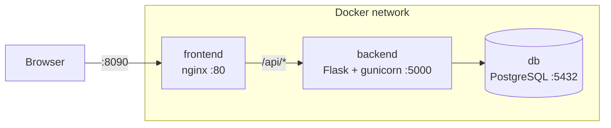

# Task Manager


A three-tier task management web app, fully containerized. A vanilla JS frontend served by nginx talks to a Flask REST API backed by PostgreSQL, and the whole stack starts with a single command.


## Features

- Create, update, filter and delete tasks (status: to do, in progress, done)
- Priority levels and optional due dates
- Arabic RTL interface, responsive on mobile
- Input validation in the API, plus `CHECK` constraints in the database
- Parameterized SQL queries (no SQL injection) and safe DOM rendering (no XSS)
- Automated tests and a CI pipeline on every push

## Architecture



nginx serves the static files and acts as a reverse proxy for `/api`, so the browser only ever talks to one origin (no CORS). Only the frontend port is published to the host; the backend and database stay on the internal Docker network.

## Tech stack

| Layer | Technology |
|---|---|
| Frontend | HTML, CSS, vanilla JavaScript, nginx |
| Backend | Python, Flask, gunicorn, psycopg2 |
| Database | PostgreSQL 16 |
| Infrastructure | Docker, Docker Compose |
| CI | GitHub Actions, pytest |

## Quick start

Requirements: Docker with the Compose plugin.

```bash
git clone https://github.com/waleednemer/task-manager-docker.git
cd task-manager-docker
docker compose up -d --build
```

Open <http://localhost:8090>.

If port 8090 is already in use, change the left side of `"8090:80"` in `docker-compose.yml`.

Stop the stack:

```bash
docker compose down        # keeps the data
docker compose down -v     # also deletes the database volume
```

## Project structure

```
.
├── docker-compose.yml
├── .github/workflows/ci.yml     # tests + Docker smoke test
├── database/
│   └── init.sql                 # schema and seed data
├── backend/
│   ├── app.py                   # Flask REST API
│   ├── tests/                   # pytest suite
│   ├── requirements.txt
│   └── Dockerfile
└── frontend/
    ├── index.html
    ├── css/  js/
    ├── nginx.conf               # static files + /api reverse proxy
    └── Dockerfile
```

## API

Base path: `/api`

| Method | Endpoint | Description | Success |
|---|---|---|---|
| GET | `/tasks` | List tasks (open tasks first) | `200` |
| POST | `/tasks` | Create a task | `201` |
| PUT | `/tasks/<id>` | Update one or more fields | `200` |
| DELETE | `/tasks/<id>` | Delete a task | `204` |

Task fields:

| Field | Type | Rules |
|---|---|---|
| `title` | string | required on create, max 200 characters |
| `status` | string | `todo` (default), `doing`, `done` |
| `priority` | string | `low`, `medium` (default), `high` |
| `due_date` | string | optional, `YYYY-MM-DD` |

Errors return `{"error": "..."}` with `400` (invalid input) or `404` (task not found).

Example:

```bash
curl -X POST http://localhost:8090/api/tasks \
  -H "Content-Type: application/json" \
  -d '{"title": "Review the Dockerfile", "priority": "high", "due_date": "2026-12-01"}'
```

```json
{"id": 3, "title": "Review the Dockerfile", "status": "todo", "priority": "high", "due_date": "2026-12-01"}
```

## Testing

The test suite covers input validation (unit tests) and every endpoint against a real PostgreSQL instance (integration tests).

```bash
# temporary database for the tests
docker run --rm -d --name testdb -e POSTGRES_DB=taskdb -e POSTGRES_USER=taskuser \
  -e POSTGRES_PASSWORD=taskpass -p 127.0.0.1:5439:5432 postgres:16

cd backend
python3 -m venv venv && source venv/bin/activate
pip install -r requirements-dev.txt
DB_PORT=5439 pytest -v

docker rm -f testdb
```

## CI

On every push and pull request, GitHub Actions:

1. Starts PostgreSQL as a service container and runs the pytest suite.
2. Builds the full Docker Compose stack, waits for the API to answer through nginx, then tears it down.

## Operations cheat sheet

```bash
docker compose ps -a                      # status of all services
docker compose logs -f backend            # follow backend logs
docker compose up -d --build backend      # rebuild after changing backend code
docker exec -it taskdb psql -U taskuser -d taskdb   # open a database shell
```

## Configuration

Database settings are passed as environment variables in `docker-compose.yml` (`DB_HOST`, `DB_PORT`, `DB_NAME`, `DB_USER`, `DB_PASSWORD`). The default credentials are for local development only; change them before any real deployment.

## Roadmap

- [ ] Push images to Docker Hub from CI
- [ ] Health endpoint and container healthchecks for backend and frontend
- [ ] Authentication and per-user tasks
- [ ] Secrets via `.env` / Docker secrets
- [ ] Monitoring with Prometheus and Grafana